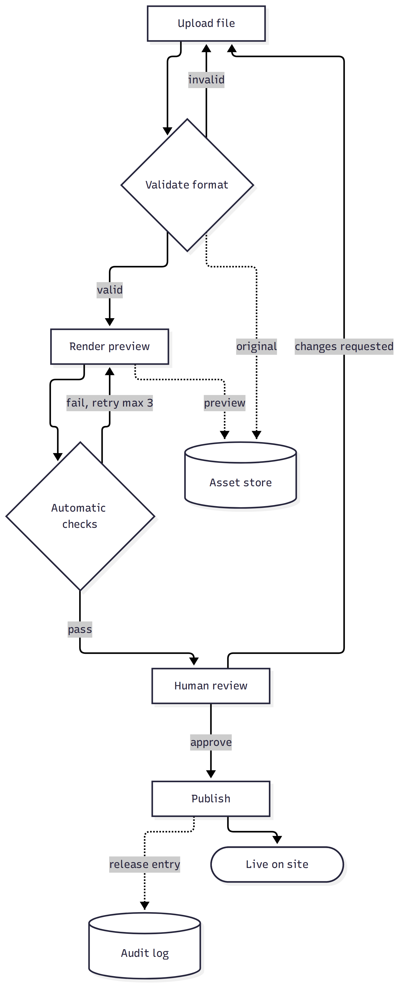
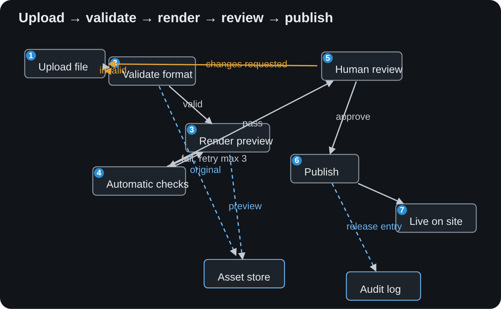
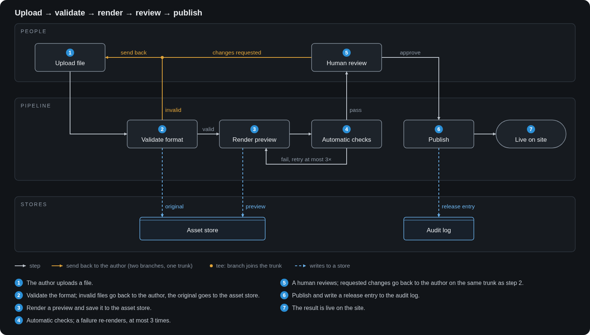

# nice-flowchart-layout

A [Claude Code](https://docs.claude.com/en/docs/claude-code) skill that makes Claude draw
flowcharts and architecture diagrams that are actually readable. Left to its defaults, a
model (or a diagram library) produces diagonal arrows through boxes, labels sitting on
lines, cramped gaps and badges parked in corners. `flowchart-rules` gives Claude a short,
binding rule set for routing, spacing and node layout, plus a render-and-inspect loop, so
the diagram is checked on a real screenshot before it is called done. It works for
hand-written inline SVG, mermaid, slides or any other medium.

## Install

Copy the skill folder into a skills directory Claude Code reads:

```bash
git clone https://github.com/manuel-bopp/nice-flowchart-layout.git

# for all your projects
mkdir -p ~/.claude/skills && cp -r nice-flowchart-layout/skills/flowchart-rules ~/.claude/skills/

# or for one project only
mkdir -p .claude/skills && cp -r nice-flowchart-layout/skills/flowchart-rules .claude/skills/
```

Start a new Claude Code session. Claude Code reads the skill's `name` and `description`
at startup and loads the full rules when a task matches, e.g. "draw the architecture as a
flowchart" or "add a diagram to the README". You can also invoke it directly with
`/flowchart-rules`. The screenshot verification step expects a headless browser
(for example Playwright) to be available.

## What the rules cover

- **Arrow routing:** orthogonal edges only, minimum segment length, anchor slots spaced
  evenly by edge count, clearance from foreign borders, minimum gaps between cards,
  lanes and their containers (on all four sides).
- **Crossing discipline:** no edge through a node, text treated as an obstacle,
  parallel edges kept apart, merge trunks as the one allowed overlap.
- **Node interior:** labels truly centred (with the baseline arithmetic SVG needs),
  one consistent badge + label arrangement per diagram.
- **Structure defaults:** actors as swimlanes, passive stores in their own strip,
  loops routed around, few edge encodings with a legend, the caption as a numbered list.
- **Process:** concept before pixels, screenshot-verify every iteration, hand-built SVG
  when geometry carries meaning.

## Before / after

The same content three times: a generic upload, validate, render, review, publish
pipeline with a retry loop, a human review step that can send work back, and two stores.

### 1. Mermaid default

Plain mermaid source ([`examples/before-mermaid.mmd`](examples/before-mermaid.mmd)),
rendered with mermaid-cli and its default layout: one tall column, long return edges
wrapped around the whole chart, no notion of who does what.



### 2. Hand-drawn without the skill

A naive inline SVG ([`examples/before-handdrawn.svg`](examples/before-handdrawn.svg)):
diagonal arrows through boxes, two return edges on top of each other, labels on the
lines, cramped gaps, badges in corners and off-centre text.



### 3. With the skill

Drawn following every rule in `SKILL.md`
([`examples/after-skill.svg`](examples/after-skill.svg)): people on top, the pipeline in
the middle, stores in a strip at the bottom; orthogonal edges only; the two "send back"
edges merge into one trunk with a single arrowhead; the local retry loop routed below;
labels clear of every line; a legend and a numbered caption list inside the image.



The SVG sources in [`examples/`](examples/) keep the text selectable; GitHub shows images, so the README embeds PNGs.

## License

[MIT](LICENSE)
